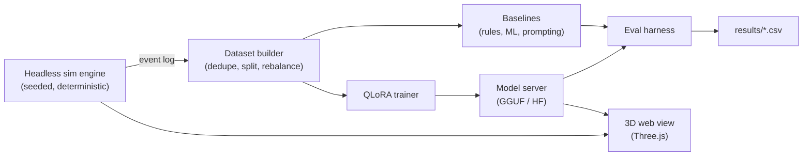
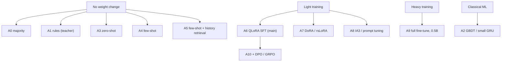

# Smart House SLM

Fine-tuning small language models (QLoRA) for context-aware home automation, evaluated in a web-based 3D smart-house simulator.

PIVIC research plan · UFLA · linked to SiR.AI (CNPq/MCTI/FNDCT nº 21/2024) · Student: Murilo Santos · Advisor: Dr. Paulo H. L. Rettore

> **Status: protocol draft v0. No results yet.** Every number in this README must come from a run logged in `results/`. Cells marked `TBD` are intentionally empty.

---

## 1. Research questions and hypotheses

Central question: *can a small language model (3–4B), fine-tuned with QLoRA on simulated household data, infer a resident's preferences from context and history and control devices accurately, safely and cheaply, compared with prompting and non-LLM baselines?*

| ID | Question | Hypothesis (fixed before running) | Decision rule |
|----|----------|-----------------------------------|---------------|
| RQ1 | Does fine-tuning beat prompting? | **H1:** QLoRA SFT (A6) beats the best few-shot arm (A4/A5) by at least 5 points of exact-match on **Test B** (unseen residents). | 95% paired-bootstrap CI of the difference excludes 0 and the mean is ≥ 5 points |
| RQ1b | Does it match the teacher? | **H2:** A6 is within 3 points of the rule policy (A1) on **Test A** (unseen days). | CI lower bound of (A6 − A1) > −3 points (non-inferiority) |
| RQ2 | What does the cost curve look like? | **H3:** accuracy saturates by about 2,000 training examples; LoRA rank above 16 adds less than 1 point. | Learning curve plus rank ablation, 3 seeds each |
| RQ3 | Is it resilient to bad data (SiR.AI data-quality theme)? | **H4:** with 20% of sensor readings missing, A6 loses fewer points than the best few-shot arm. | Paired comparison on **Test C** |

A negative result (any hypothesis rejected) is reported with the same detail as a positive one.

## 2. System at a glance



The 3D view is an **instrument, not a result**: it replays logged states for debugging, error analysis, demos and (later) human rating. It never changes simulator state, so findings do not depend on rendering.

## 3. Paradigms compared (the experimental arms)



| Arm | Paradigm | Training | Key settings |
|-----|----------|----------|--------------|
| A0 | Always "do nothing" | none | sanity floor |
| A1 | Rule policy (the teacher) | none | reference ceiling, not a competitor |
| A2 | Classical ML on the same features | yes (small) | gradient-boosted trees or GRU; no LLM, to test whether an LLM is needed |
| A3 | Base model, zero-shot | none | temperature 0, `max_new_tokens=48`, same parser as tuned arms |
| A4 | Base model, few-shot | none | k in {1, 5, 10, 20}; pool = training split only; random (3 seeds) vs nearest-neighbour selection (time bucket, room/activity, device state) |
| A5 | Few-shot + retrieved resident history | none | adds the resident's recent events to the prompt (personalization via retrieval) |
| A6 | **QLoRA SFT (main)** | yes | 4-bit NF4, r=16, alpha=16, dropout 0, all linear layers, lr 2e-4, 1 epoch, effective batch 16, 8-bit AdamW, loss on the answer only |
| A7 | DoRA / rsLoRA | yes | A6 with `use_dora=True`; rsLoRA at r=64 |
| A8 | (IA)3 / prompt tuning | yes | (IA)3: k, v, down_proj, lr about 3e-3; prompt tuning: 20 virtual tokens, lr about 3e-2 |
| A9 | Full fine-tune of a ~0.5B model | yes | lr about 1e-5, 8-bit optimizer; reference for how far PEFT is from full tuning |
| A10 | A6 + preference/RL stage | yes | DPO beta 0.1; rejected = unsafe or wrong actions generated by the simulator |

Base models: `Llama-3.2-3B-Instruct` (main) and `Qwen3-4B-Instruct-2507` (replication). Llama has no 4B size.

**Fairness rules:** all arms share the same system prompt, output parser, decoding settings, training pool and test splits. Few-shot examples count toward reported prompt tokens.

## 4. What the prompting baseline looks like

```text
SYSTEM: You control a smart home. Given the state, predict the resident's next room
and the device actions to take. Answer in exactly this format:
next: <room>
do: [<device>=<value>, ...]        # use [] when nothing should change

STATE:                              # example 1 of k (from the training pool only)
t: Mon 06:40
at: bedroom/waking
temp: {in: 17.2, out: 6.1}
dev: {lights: [], heat: 17, coffee: off, lock: locked}
ANSWER:
next: bathroom
do: [light.bedroom=on, heat=21]

... (k examples) ...

STATE:                              # the query
<state of the decision to predict>
ANSWER:
```

## 5. Data and splits

| Split | Contents | Tests |
|-------|----------|-------|
| Train | about 20 simulated residents (sampled preferences, routines, layouts) | |
| Validation | about 4 residents | hyperparameter choices only |
| **Test A** | unseen days of training residents | in-distribution accuracy |
| **Test B** | unseen residents | generalization to new preferences (main claim) |
| **Test C** | Test B with 10/20/30% missing or noisy readings and a changed layout | resilience |
| Test D (optional) | public real-home data, next-room prediction only | external validity |

Rules: split by resident or day, never by row; dedupe; keep all action rows and a small fraction of idle rows; store a dataset hash; test splits are never used for tuning.

## 6. Metrics

| Metric | Definition | Level |
|--------|------------|-------|
| **Exact action match** (primary) | predicted action set equals the gold set | per decision |
| Next-room accuracy | predicted next room equals the routine's next room | per decision |
| Macro-F1 | F1 over each `device=value` label, averaged | per label |
| Format validity | output parses into `next` and `do` | per decision |
| Safety violation rate | decisions breaking hard rules (for example unlock while away) | per decision |
| Outcome success (closed loop) | simulator predicates hold after the model acts: temperature near preference while home, lights on only when occupied and dark, door locked when away or asleep | per simulated day |
| Resilience | accuracy drop at 10/20/30% missing readings | per split |
| Efficiency | p50/p95 latency (T4 and CPU), peak VRAM, trainable parameters, training minutes, tokens per decision | per arm |

## 7. Ablations

Primary (always run, 3 seeds each):

| Ablation | Levels | Everything else fixed at | Readout |
|----------|--------|--------------------------|---------|
| Training data size | 250, 500, 1000, 2000, 4000 | A6 | learning curve (H3) |
| LoRA rank | 4, 8, 16, 64 | A6, 2000 examples | accuracy vs trainable parameters (H3) |
| History window | 0, 6, 12, 24 events | A6 | does the model use history? |
| Few-shot k and selection | 0, 1, 5, 10, 20; random vs retrieved | base model | strength of the prompting baseline (H1) |
| Method | A6 vs A7 vs A8 vs A9 | same data, same seeds | PEFT comparison table |

Secondary (if time allows): target modules (attention-only vs all linear), epochs 1/2/3, learning rate (5e-5 to 4e-4), loss masking (answer-only vs full), idle-row ratio (5%, 20%, 100%), input format (YAML vs JSON vs prose), inference quantization (16/8/4-bit), teacher type (rules vs LLM-generated labels), base model.

Compute budget: the primary grid is roughly 60 to 80 short runs. On a free Colab T4 at 5 to 15 minutes each, this is feasible if every adapter is saved to Drive after its run.

## 8. Statistical protocol

- Seeds: 0, 1, 2 (5 for the main comparison if time allows).
- Report mean ± std over seeds and a 95% paired-bootstrap CI (10,000 resamples) on the same test items.
- Holm correction across the primary comparisons.
- At least 1,000 rows per test split (about ±1.9 points at 90% accuracy; 120 rows would give ±5.4).
- Greedy decoding for all arms.
- Freeze `PROTOCOL.md` with a Git tag (`protocol-v1`) before the first test-set evaluation; later changes go in a dated "Deviations" section.

## 9. Results (to be filled from `results/`)

**Main comparison** (exact action match, %, mean ± std over seeds)

| Arm | Test A | Test B | Test C (20% missing) | Format valid | Unsafe rate | p50 latency (ms) | Peak VRAM (GB) | Trainable params |
|-----|--------|--------|----------------------|--------------|-------------|------------------|----------------|------------------|
| A0 majority | TBD | TBD | TBD | TBD | TBD | TBD | TBD | 0 |
| A1 rules | TBD | TBD | TBD | TBD | TBD | TBD | TBD | 0 |
| A2 classical ML | TBD | TBD | TBD | TBD | TBD | TBD | TBD | TBD |
| A3 zero-shot | TBD | TBD | TBD | TBD | TBD | TBD | TBD | 0 |
| A4 few-shot (best k) | TBD | TBD | TBD | TBD | TBD | TBD | TBD | 0 |
| A5 few-shot + history | TBD | TBD | TBD | TBD | TBD | TBD | TBD | 0 |
| **A6 QLoRA** | TBD | TBD | TBD | TBD | TBD | TBD | TBD | TBD |
| A7 DoRA | TBD | TBD | TBD | TBD | TBD | TBD | TBD | TBD |
| A8 (IA)3 | TBD | TBD | TBD | TBD | TBD | TBD | TBD | TBD |
| A9 full FT (0.5B) | TBD | TBD | TBD | TBD | TBD | TBD | TBD | TBD |

**Figures to produce** (saved in `figures/`): `learning_curve.png` (data size vs accuracy per arm), `rank_vs_accuracy.png`, `robustness.png` (accuracy vs % missing readings), `latency_vs_accuracy.png`, and `error_breakdown.png` (errors by device and by time of day).

**Error analysis:** for each arm, 20 sampled mistakes, categorized (wrong room, wrong device, wrong value, format error, unsafe action). Each one can be replayed in the 3D view.

## 10. Reproducibility

```text
smart-house-slm/
├─ engine/        # headless, seeded simulator (single source of truth)
├─ web/           # 3D viewer (Three.js), reads logged states only
├─ data/          # generated datasets + hashes
├─ train/         # qlora.py, configs/*.yaml
├─ eval/          # metrics.py, bootstrap.py, prompts/
├─ results/       # one CSV row per (arm, seed, split)
├─ notebooks/     # Colab notebooks
├─ figures/
├─ PROTOCOL.md
└─ README.md
```

`results/` schema: `run_id, arm, base_model, seed, split, n, exact, next_acc, f1_macro, fmt_valid, unsafe_rate, latency_ms, vram_gb, trainable_params, train_minutes, git_hash, data_hash`.

Log for every run: config, seed, git hash, library versions, dataset hash, and raw model outputs. Publish a dataset card and a model card with the adapters.

## 11. Threats to validity

- **Circular labels:** if the teacher is a fixed rule set, the model can only copy it. Mitigation: hidden resident preferences that must be inferred from history, and outcome-based evaluation in the simulator.
- **Sim-to-real gap:** synthetic routines are not real households. Mitigation: Test D and honest limitations.
- **Prompt sensitivity:** few-shot results vary with wording and example choice. Mitigation: several prompts and selection strategies, reported as a range.
- **Small test sets and Colab variance:** mitigated by at least 1,000 test rows and multiple seeds.
- **Library drift:** pin versions and record them per run.

## 12. Timeline (PIVIC phases)

| Months | Work |
|--------|------|
| 1–3 | Protocol v1, headless engine, baselines A0–A5, dataset v1 |
| 4–8 | Main grid (A6–A9), ablations, 3D view first version |
| 9–12 | Robustness and closed-loop tests, error analysis, report, CIUFLA presentation |

## 13. References

- Hu et al., *LoRA: Low-Rank Adaptation of Large Language Models*, arXiv:2106.09685
- Dettmers et al., *QLoRA: Efficient Finetuning of Quantized LLMs*, arXiv:2305.14314
- HomeFlow: a data flywheel for smart-home agent training with verifiable simulation, arXiv:2606.01230
- AdaHome: an adaptive smart home assistant using local small language models, arXiv:2607.18034
- Birkmose et al., *On-device LLMs for Home Assistant: dual role in intent detection and response generation*, arXiv:2502.12923
- HomeBench: evaluating LLMs in smart homes with valid and invalid instructions, arXiv:2505.19628
- Paul et al., *Enabling Device Control Planning Capabilities of Small Language Model*, ICASSP 2024
- Cruz, Rettore, Santos, *Análise do uso de LLMs na geração de códigos para automação residencial*, WebMedia 2025, doi:10.5753/webmedia.2025.15971
