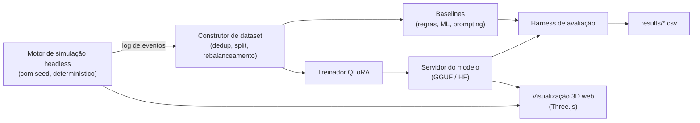
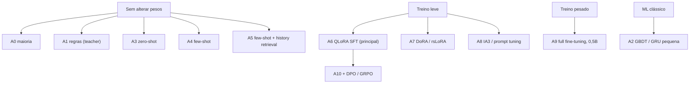

# Smart House SLM

Fine-tuning de modelos de linguagem pequenos (QLoRA) para automação residencial sensível ao contexto, avaliado em um simulador web 3D de casa inteligente.

Plano PIVIC · UFLA · vinculado ao projeto SiR.AI (CNPq/MCTI/FNDCT nº 21/2024) · Aluno: Murilo Santos · Orientador: Dr. Paulo H. L. Rettore

> **Status: rascunho do protocolo v0. Ainda não há resultados.** Todo número deste README deve vir de um run registrado em `results/`. As células marcadas com `TBD` estão vazias de propósito.

---

## 1. Perguntas de pesquisa e hipóteses

Pergunta central: *um modelo de linguagem pequeno (3–4B), ajustado com QLoRA em dados domésticos simulados, consegue inferir as preferências de um morador a partir do contexto e do histórico e controlar dispositivos com precisão, segurança e baixo custo, em comparação com prompting e baselines sem LLM?*

| ID | Pergunta | Hipótese (fixada antes de rodar) | Regra de decisão |
|----|----------|----------------------------------|------------------|
| RQ1 | O fine-tuning supera o prompting? | **H1:** o QLoRA SFT (A6) supera o melhor arm few-shot (A4/A5) em pelo menos 5 pontos de exact match no **Teste B** (moradores nunca vistos). | O CI de 95% da diferença (paired bootstrap) exclui 0 e a média é ≥ 5 pontos |
| RQ1b | Ele iguala o professor (teacher)? | **H2:** o A6 fica a até 3 pontos da rule policy (A1) no **Teste A** (dias nunca vistos). | Limite inferior do CI de (A6 − A1) > −3 pontos (non-inferiority) |
| RQ2 | Como é a curva de custo? | **H3:** a accuracy satura por volta de 2.000 exemplos de treino; rank de LoRA acima de 16 acrescenta menos de 1 ponto. | Learning curve e ablation de rank, 3 seeds cada |
| RQ3 | Tem resilience a dados ruins (tema de data quality do SiR.AI)? | **H4:** com 20% das leituras de sensores faltando, o A6 perde menos pontos que o melhor arm few-shot. | Comparação pareada no **Teste C** |

Um resultado negativo (qualquer hipótese rejeitada) é relatado com o mesmo detalhe que um resultado positivo.

## 2. Visão geral do sistema



A visualização 3D é um **instrumento, não um resultado**: ela reproduz estados registrados para depuração, análise de erros, demonstrações e (futuramente) avaliação humana. Ela nunca altera o estado do simulador, então as conclusões não dependem da renderização.

## 3. Paradigmas comparados (os arms do experimento)



| Arm | Paradigma | Treino | Configurações principais |
|-------|-----------|--------|--------------------------|
| A0 | Sempre "não fazer nada" | nenhum | sanity floor |
| A1 | Rule policy (o teacher) | nenhum | reference ceiling, não é um concorrente |
| A2 | ML clássico nas mesmas features | sim (pequeno) | árvores com gradient boosting ou GRU; sem LLM, para testar se um LLM é necessário |
| A3 | Modelo base, zero-shot | nenhum | temperatura 0, `max_new_tokens=48`, mesmo parser dos arms ajustados |
| A4 | Modelo base, few-shot | nenhum | k em {1, 5, 10, 20}; pool = apenas o split de treino; seleção random (3 seeds) vs nearest-neighbour (faixa de horário, cômodo/atividade, estado dos dispositivos) |
| A5 | Few-shot + retrieval do histórico do morador | nenhum | adiciona ao prompt os eventos recentes do morador (personalização via retrieval) |
| A6 | **QLoRA SFT (principal)** | sim | NF4 em 4 bits, r=16, alpha=16, dropout 0, all linear layers, lr 2e-4, 1 época, batch efetivo 16, AdamW 8 bits, loss só na resposta |
| A7 | DoRA / rsLoRA | sim | A6 com `use_dora=True`; rsLoRA com r=64 |
| A8 | (IA)3 / prompt tuning | sim | (IA)3: k, v, down_proj, lr cerca de 3e-3; prompt tuning: 20 virtual tokens, lr cerca de 3e-2 |
| A9 | Full fine-tuning de um modelo de ~0,5B | sim | lr cerca de 1e-5, optimizer de 8 bits; referência de quão longe o PEFT está do ajuste completo |
| A10 | A6 + etapa de preferência/RL | sim | DPO com beta 0,1; rejeitadas = ações inseguras ou erradas geradas pelo simulador |

Modelos base: `Llama-3.2-3B-Instruct` (principal) e `Qwen3-4B-Instruct-2507` (replicação). O Llama não tem tamanho de 4B.

**Regras de justiça:** todos os arms usam o mesmo prompt de sistema, parser de saída, configurações de decodificação, pool de treino e splits de teste. Os exemplos few-shot contam nos tokens de prompt reportados.

## 4. Como é o baseline de prompting

O prompt e os dados ficam em inglês, que é o formato de entrada do modelo.

```text
SYSTEM: You control a smart home. Given the state, predict the resident's next room
and the device actions to take. Answer in exactly this format:
next: <room>
do: [<device>=<value>, ...]        # use [] when nothing should change

STATE:                              # exemplo 1 de k (somente do pool de treino)
t: Mon 06:40
at: bedroom/waking
temp: {in: 17.2, out: 6.1}
dev: {lights: [], heat: 17, coffee: off, lock: locked}
ANSWER:
next: bathroom
do: [light.bedroom=on, heat=21]

... (k exemplos) ...

STATE:                              # a consulta
<estado da decisão a ser prevista>
ANSWER:
```

## 5. Dados e splits

| Split | Conteúdo | O que testa |
|-------|----------|-------------|
| Train | cerca de 20 moradores simulados (preferências, rotinas e layouts amostrados) | |
| Validation | cerca de 4 moradores | apenas escolhas de hyperparameters |
| **Teste A** | dias nunca vistos dos moradores de treino | in-distribution accuracy |
| **Teste B** | moradores nunca vistos | generalização para novas preferências (alegação principal) |
| **Teste C** | Teste B com 10/20/30% de leituras ausentes ou ruidosas e layout alterado | resilience |
| Teste D (opcional) | dados públicos de casas reais, apenas previsão do próximo cômodo | validade externa |

Regras: fazer split por morador ou por dia, nunca por linha; fazer dedup; manter todas as linhas com ação e uma pequena fração das linhas idle; guardar o hash do dataset; os splits de teste nunca são usados para ajuste.

## 6. Métricas

| Métrica | Definição | Nível |
|---------|-----------|-------|
| **Exact action match** (primária) | o conjunto de ações previsto é igual ao conjunto correto | por decisão |
| Next-room accuracy | o próximo cômodo previsto é igual ao da rotina | por decisão |
| Macro-F1 | F1 de cada label `dispositivo=valor`, com média entre labels | por label |
| Format validity | a saída é interpretável em `next` e `do` | por decisão |
| Safety violation rate | decisões que quebram regras rígidas (por exemplo, destrancar a porta com o morador fora) | por decisão |
| Outcome success (closed-loop) | predicados do simulador valem após o modelo agir: temperatura próxima da preferência com o morador em casa, luzes acesas só quando ocupado e escuro, porta trancada quando fora ou dormindo | por dia simulado |
| Resilience | queda de accuracy com 10/20/30% de leituras ausentes | por split |
| Efficiency | p50/p95 latency (T4 e CPU), peak VRAM, trainable parameters, minutos de treino, tokens por decisão | por arm |

## 7. Ablations

Primárias (sempre executadas, 3 seeds cada):

| Ablation | Níveis | Todo o resto fixo em | Leitura |
|---------|--------|----------------------|---------|
| Tamanho dos dados de treino | 250, 500, 1000, 2000, 4000 | A6 | learning curve (H3) |
| Rank do LoRA | 4, 8, 16, 64 | A6, 2000 exemplos | accuracy vs trainable parameters (H3) |
| History window | 0, 6, 12, 24 eventos | A6 | o modelo usa o histórico? |
| k do few-shot e seleção | 0, 1, 5, 10, 20; random vs retrieved | modelo base | força do baseline de prompting (H1) |
| Método | A6 vs A7 vs A8 vs A9 | mesmos dados, mesmas seeds | tabela comparativa de PEFT |

Secundárias (se houver tempo): target modules (attention-only vs all-linear), epochs 1/2/3, learning rate (5e-5 a 4e-4), loss masking (answer-only vs full sequence), idle ratio (5%, 20%, 100%), input format (YAML vs JSON vs prose), inference quantization (16/8/4 bits), tipo de teacher (regras vs labels gerados por LLM), modelo base.

Compute budget: a grade primária tem cerca de 60 a 80 runs curtos. Em uma T4 gratuita do Colab, com 5 a 15 minutos cada, isso é viável se cada adapter for salvo no Drive ao fim do run.

## 8. Protocolo estatístico

- Seeds: 0, 1, 2 (5 para a comparação principal, se houver tempo).
- Reportar média ± desvio padrão entre seeds e um CI de 95% por paired bootstrap (10.000 resamples) sobre os mesmos itens de teste.
- Holm correction entre as comparações primárias.
- Pelo menos 1.000 linhas por split de teste (cerca de ±1,9 ponto com 90% de accuracy; 120 linhas dariam ±5,4).
- Greedy decoding em todos os arms.
- Congelar o `PROTOCOL.md` com uma tag do Git (`protocol-v1`) antes da primeira avaliação no conjunto de teste; mudanças posteriores vão em uma seção datada de "Desvios".

## 9. Resultados (a preencher a partir de `results/`)

**Comparação principal** (exact action match, %, média ± desvio entre seeds)

| Arm | Teste A | Teste B | Teste C (20% ausentes) | Format valid | Unsafe rate | p50 latency (ms) | Peak VRAM (GB) | Trainable params |
|-------|---------|---------|------------------------|----------------|-------------------|-------------------|-------------------|-----------------------|
| A0 maioria | TBD | TBD | TBD | TBD | TBD | TBD | TBD | 0 |
| A1 regras | TBD | TBD | TBD | TBD | TBD | TBD | TBD | 0 |
| A2 ML clássico | TBD | TBD | TBD | TBD | TBD | TBD | TBD | TBD |
| A3 zero-shot | TBD | TBD | TBD | TBD | TBD | TBD | TBD | 0 |
| A4 few-shot (melhor k) | TBD | TBD | TBD | TBD | TBD | TBD | TBD | 0 |
| A5 few-shot + histórico | TBD | TBD | TBD | TBD | TBD | TBD | TBD | 0 |
| **A6 QLoRA** | TBD | TBD | TBD | TBD | TBD | TBD | TBD | TBD |
| A7 DoRA | TBD | TBD | TBD | TBD | TBD | TBD | TBD | TBD |
| A8 (IA)3 | TBD | TBD | TBD | TBD | TBD | TBD | TBD | TBD |
| A9 full FT (0,5B) | TBD | TBD | TBD | TBD | TBD | TBD | TBD | TBD |

**Figuras a produzir** (salvas em `figures/`): `learning_curve.png` (tamanho dos dados vs accuracy por arm), `rank_vs_accuracy.png`, `robustness.png` (accuracy vs % de leituras ausentes), `latency_vs_accuracy.png` e `error_breakdown.png` (erros por dispositivo e por horário).

**Análise de erros:** para cada arm, 20 erros amostrados e classificados (cômodo errado, dispositivo errado, valor errado, erro de formato, ação insegura). Cada um pode ser reproduzido na visualização 3D.

## 10. Reprodutibilidade

```text
smart-house-slm/
├─ engine/        # simulador headless com seed (fonte única da verdade)
├─ web/           # visualizador 3D (Three.js), lê apenas estados registrados
├─ data/          # datasets gerados + hashes
├─ train/         # qlora.py, configs/*.yaml
├─ eval/          # metrics.py, bootstrap.py, prompts/
├─ results/       # uma linha de CSV por (arm, seed, split)
├─ notebooks/     # notebooks do Colab
├─ figures/
├─ PROTOCOL.md
└─ README.md
```

Esquema de `results/`: `run_id, arm, base_model, seed, split, n, exact, next_acc, f1_macro, fmt_valid, unsafe_rate, latency_ms, vram_gb, trainable_params, train_minutes, git_hash, data_hash`.

Registrar em todo run: configuração, seed, hash do git, versões das bibliotecas, hash do dataset e as saídas brutas do modelo. Publicar um dataset card e um model card junto com os adapters.

## 11. Ameaças à validade

- **Labels circulares:** se o teacher é um conjunto fixo de regras, o modelo só pode copiá-lo. Mitigação: preferências ocultas dos moradores que precisam ser inferidas do histórico e avaliação baseada em resultado no simulador.
- **Lacuna sim-to-real:** rotinas sintéticas não são casas reais. Mitigação: Teste D e limitações declaradas com honestidade.
- **Sensibilidade ao prompt:** os resultados de few-shot variam com a redação e com a escolha dos exemplos. Mitigação: vários prompts e estratégias de seleção, reportados como uma faixa.
- **Conjuntos de teste pequenos e variância do Colab:** mitigados com pelo menos 1.000 linhas de teste e várias seeds.
- **Deriva de bibliotecas:** fixar as versões e registrá-las por execução.

## 12. Cronograma (fases do PIVIC)

| Meses | Trabalho |
|-------|----------|
| 1–3 | Protocolo v1, motor headless, baselines A0–A5, dataset v1 |
| 4–8 | Grade principal (A6–A9), ablations, primeira versão da visualização 3D |
| 9–12 | Testes de robustez e closed-loop, análise de erros, relatório, apresentação no CIUFLA |

## 13. Referências

- Hu et al., *LoRA: Low-Rank Adaptation of Large Language Models*, arXiv:2106.09685
- Dettmers et al., *QLoRA: Efficient Finetuning of Quantized LLMs*, arXiv:2305.14314
- HomeFlow: a data flywheel for smart-home agent training with verifiable simulation, arXiv:2606.01230
- AdaHome: an adaptive smart home assistant using local small language models, arXiv:2607.18034
- Birkmose et al., *On-device LLMs for Home Assistant: dual role in intent detection and response generation*, arXiv:2502.12923
- HomeBench: evaluating LLMs in smart homes with valid and invalid instructions, arXiv:2505.19628
- Paul et al., *Enabling Device Control Planning Capabilities of Small Language Model*, ICASSP 2024
- Cruz, Rettore, Santos, *Análise do uso de Modelos de Linguagem de Grande Escala na Geração de Códigos para Automação Residencial*, WebMedia 2025, doi:10.5753/webmedia.2025.15971
